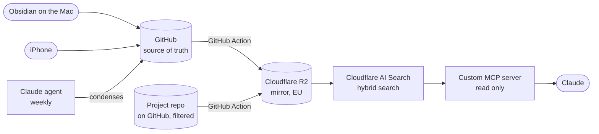

<h1 align="center">Second Brain with a Custom MCP Server</h1>

  Questions in Claude are answered from my own notes and project repos, 
  with sources. No machine of my own has to keep running.

  
  
  
  
  

<a href="README.md">Deutsch</a> · <b>English</b>

---

## What is it about?

Knowledge is scattered across notes, project folders and decision logs. Anyone with a question
either searches five folders or asks a language model that does not know their own documents.

The Second Brain connects both. I ask in Claude and get an answer from my own documents, naming
the file it comes from. When the system does not know something, it says so instead of guessing.

## Architecture

**Three layers:**
- **Raw material:** notes, transcripts, project documents, as they are created
- **Condensed pages:** every week a Claude agent reads the new material and writes wiki pages on
  topics, projects and contacts, with cross-references and sources
- **Search:** Claude queries the condensed pages first and only falls back to the raw material
  when needed

## The MCP server

A small server on Cloudflare Workers through which Claude accesses the search. Three tools, all
read only:

| Tool | Purpose |
|---|---|
| `notizen_suchen` | Hybrid semantic and keyword search across all documents |
| `seite_lesen` | Read a full page instead of a snippet |
| `index_stand` | How current the search index is |

## Building blocks

| Task | Service |
|---|---|
| Writing notes on the Mac | Obsidian, Obsidian Git pushes changes to GitHub automatically |
| Capturing notes on the iPhone | Obsidian with GitSync |
| Source of truth and versioning | GitHub |
| Sync, archive, health check | GitHub Actions |
| Storage | Cloudflare R2 |
| Search index | Cloudflare AI Search |
| MCP server | Cloudflare Workers |
| Login | Cloudflare, one-time code by email, a single allowed address |
| Asking questions | Claude |
| Condensing and weekly check | Scheduled Claude agents in the cloud |

## Proven in acceptance testing

| Test | Result |
|---|---|
| Ten test questions, including one that has no answer | 9 of 10 correct with the correct source, nothing invented for the negative question |
| New note findable | within 30 minutes |
| Capture on the iPhone without the Mac | no conflict with simultaneous changes on the Mac |
| Deleted and renamed files | also disappear from the index and from answers |
| Access | only after login, a foreign account is rejected |
| Private journal folder | not findable |
| Broken index | fully rebuildable from GitHub |
| Condensing | 71 pages from the existing material, all acceptance criteria passed |

## Operations

- **Nightly health check** as a GitHub Action, without AI: server reachable, access without login
  rejected, a real test question returns hits, keys do not expire unnoticed
- **Weekly review agent** in the cloud: reads both repos, checks the building blocks and reports as
  a GitHub issue. It is not allowed to change anything
- **Weekly condensing** by a Claude agent in the cloud. Without new material it writes nothing
- **Weekly archive** in a separate storage bucket

A lesson from operations: in September a search component failed while the health check reported
"all fine", because it only checked that the parts existed. Since then it asks a real test question
every night.

## Privacy and security

| Principle | Implementation |
|---|---|
| Read only | The MCP server cannot write, change or delete anything |
| Only me | Login with a one-time code, foreign accounts are not offered any tools |
| Private areas | The private journal is backed up but not in the search index |
| Nothing gets lost | GitHub is the source of truth, the index is only a copy |
| Storage location | Mirror in Cloudflare R2, EU region |
| Injected instructions | Content from the documents counts as material for the agent, not as instructions |

## How it was built

Target picture, architecture, acceptance criteria and sign-off are mine. The implementation is
AI-assisted with Claude Code. The acceptance criteria were defined and frozen before building.

---

As of 27 September 2026. Code, configuration and content are private.
Contact: [LinkedIn](https://www.linkedin.com/in/pantelis-nanis) · [Logik-Agentur](https://logik-agentur.de)
