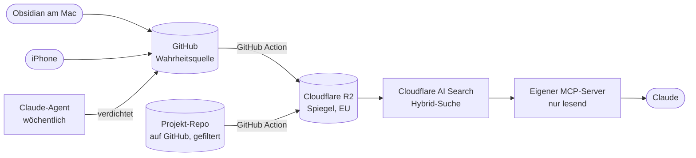

<h1 align="center">Second Brain mit eigenem MCP-Server</h1>

  Fragen in Claude beantworten sich aus den eigenen Notizen und Projekt-Repos, 
  mit Quellenangabe. Ohne dass ein eigener Rechner laufen muss.

  
  
  
  
  

<b>Deutsch</b> · <a href="README.en.md">English</a>

---

## Worum geht es?

Wissen verteilt sich über Notizen, Projektordner und Entscheidungsprotokolle. Wer eine Frage hat,
sucht in fünf Ordnern oder fragt ein Sprachmodell, das die eigenen Unterlagen nicht kennt.

Das Second Brain verbindet beides. Ich frage in Claude und bekomme eine
Antwort aus meinen eigenen Unterlagen, mit Angabe der Datei, aus der sie stammt. Weiß das System
etwas nicht, sagt es das, statt zu raten.

## Aufbau

**Drei Schichten:**
- **Rohmaterial:** Notizen, Transkripte, Projektunterlagen, so wie sie entstehen
- **Verdichtete Seiten:** Ein Claude-Agent liest jede Woche das neue Material und schreibt daraus
  Wiki-Seiten zu Themen, Projekten und Kontakten, mit Querverweisen und Quellen
- **Suche:** Claude fragt zuerst die verdichteten Seiten ab und greift nur bei Bedarf auf das
  Rohmaterial zurück

## Der MCP-Server

Ein kleiner Server auf Cloudflare Workers, über den Claude auf die Suche zugreift. Drei Werkzeuge,
alle nur lesend:

| Werkzeug | Zweck |
|---|---|
| `notizen_suchen` | Hybrid-Suche aus Bedeutung und Stichwort über alle Unterlagen |
| `seite_lesen` | Eine Seite vollständig lesen statt nur einen Ausschnitt |
| `index_stand` | Wie aktuell der Suchindex ist |

## Bausteine

| Aufgabe | Dienst |
|---|---|
| Notizen schreiben am Mac | Obsidian, Obsidian Git schiebt Änderungen automatisch nach GitHub |
| Notizen erfassen am iPhone | Obsidian mit GitSync |
| Wahrheitsquelle und Versionierung | GitHub |
| Spiegelung, Archiv, Gesundheitscheck | GitHub Actions |
| Speicher | Cloudflare R2 |
| Suchindex | Cloudflare AI Search |
| MCP-Server | Cloudflare Workers |
| Anmeldung | Cloudflare, Einmalcode per Mail, nur eine freigeschaltete Adresse |
| Fragen stellen | Claude |
| Verdichtung und Wochencheck | Claude-Agenten in der Cloud, zeitgesteuert |

## Belegt in der Abnahme

| Prüfung | Ergebnis |
|---|---|
| Zehn Testfragen, darunter eine, auf die es keine Antwort gibt | 9 von 10 richtig mit richtiger Quelle, bei der Negativfrage nichts erfunden |
| Neue Notiz auffindbar | innerhalb von 30 Minuten |
| Erfassen am iPhone ohne Mac | ohne Konflikt mit gleichzeitigen Änderungen am Mac |
| Gelöschte und umbenannte Dateien | verschwinden auch aus Index und Antworten |
| Zugriff | nur mit Anmeldung, ein fremdes Konto wird abgewiesen |
| Private Tagebuch-Ordner | nicht auffindbar |
| Index kaputt | vollständig aus GitHub neu aufbaubar |
| Verdichtung | 71 Seiten aus dem Bestand, alle Prüfkriterien bestanden |

## Betrieb

- **Nächtlicher Gesundheitscheck** als GitHub Action, ohne KI: Server erreichbar, Zugriff ohne Anmeldung
  wird abgewiesen, eine echte Testfrage liefert Treffer, Schlüssel laufen nicht unbemerkt ab
- **Wöchentlicher Prüf-Agent** in der Cloud: liest beide Repos, prüft die Bausteine und berichtet als
  GitHub-Vorgang. Er darf nichts ändern
- **Wöchentliche Verdichtung** durch einen Claude-Agenten in der Cloud. Ohne neues Material schreibt er nichts
- **Wöchentliches Archiv** in einem getrennten Speicher

Eine Lehre aus dem Betrieb: Im September fiel ein Baustein der Suche aus, während der Gesundheitscheck
"alles in Ordnung" meldete, weil er nur die Anwesenheit der Teile prüfte. Seitdem stellt er jede Nacht
eine echte Testfrage.

## Datenschutz und Sicherheit

| Grundsatz | Umsetzung |
|---|---|
| Nur lesen | Der MCP-Server kann nichts schreiben, ändern oder löschen |
| Nur ich | Anmeldung mit Einmalcode, fremde Konten bekommen keine Werkzeuge angeboten |
| Private Bereiche | Das private Tagebuch ist gesichert, aber nicht im Suchindex |
| Nichts geht verloren | GitHub ist die Wahrheitsquelle, der Index ist nur eine Kopie |
| Speicherort | Spiegel in Cloudflare R2, Region EU |
| Fremde Anweisungen | Inhalte aus den Unterlagen gelten für den Agenten als Material, nicht als Anweisung |

## Wie gebaut

Zielbild, Architektur, Prüfkriterien und Abnahme liegen bei mir. Die Umsetzung erfolgt KI-gestützt
mit Claude Code. Die Prüfkriterien wurden vor dem Bau festgelegt und eingefroren.

---

Stand: 27.09.2026. Code, Konfiguration und Inhalte sind privat.
Kontakt: [LinkedIn](https://www.linkedin.com/in/pantelis-nanis) · [Logik-Agentur](https://logik-agentur.de)
